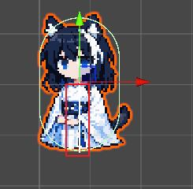
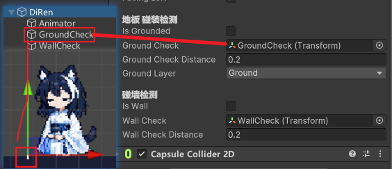
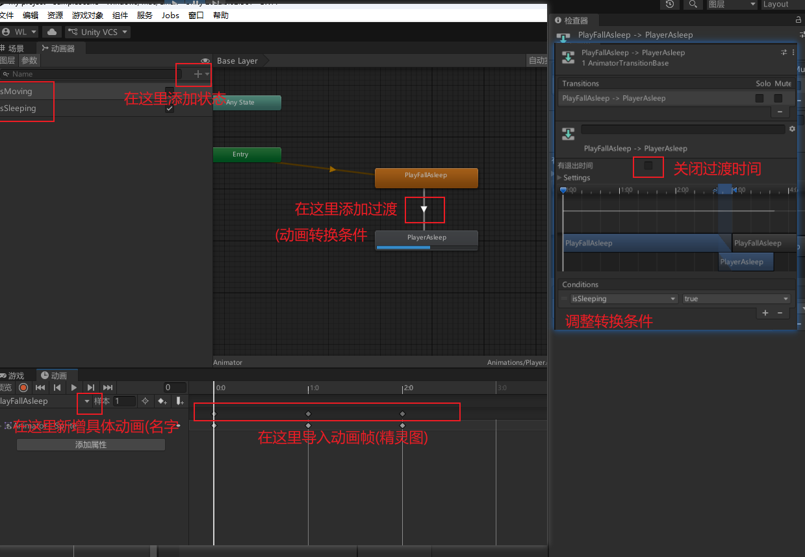
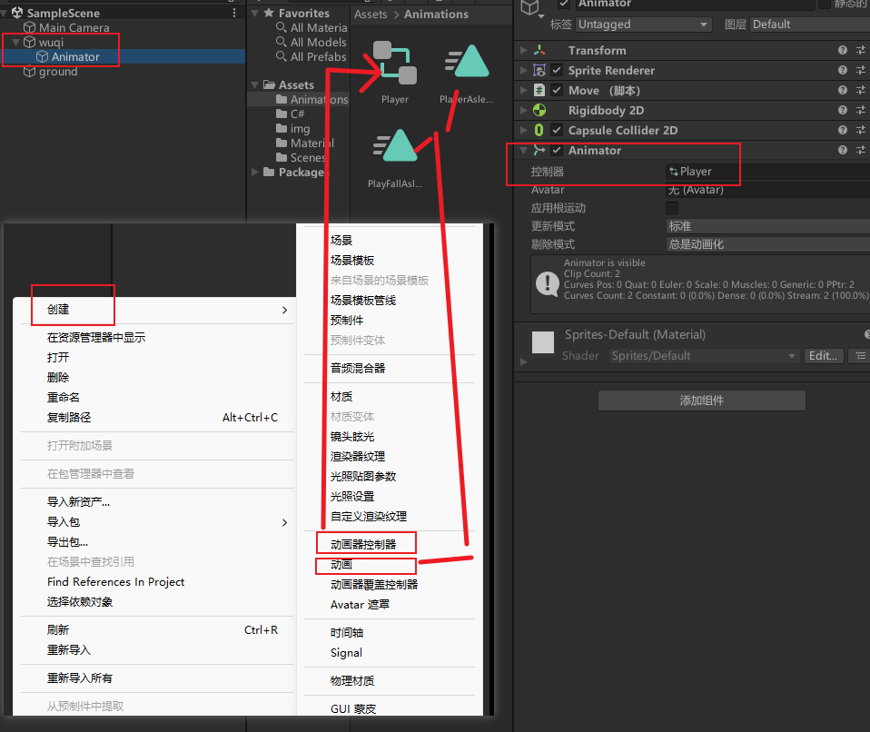
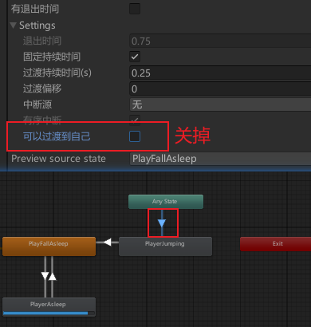
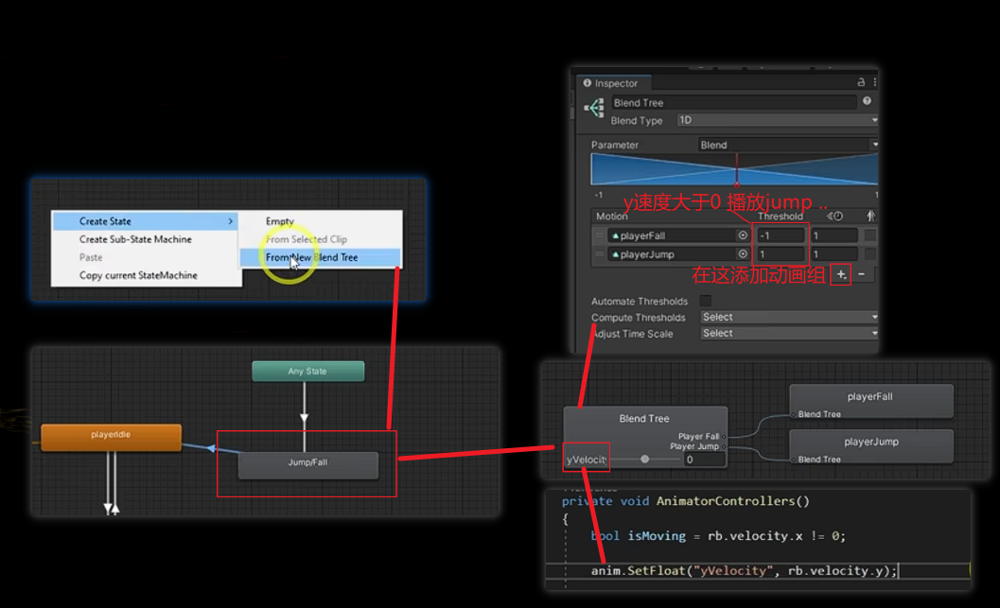
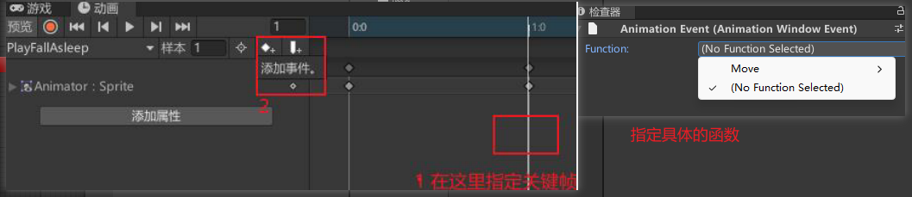

## 人物移动
```C#
using System.Collections;
using System.Collections.Generic;
using UnityEngine;

public class move : MonoBehaviour
{
    // Vector3 三维变量 vector:向量
    public Vector3 vector3;

    void Start()//创建时执行一次(类似与构造函数)
    { }

    void Update()//每一帧都会变化
    {
        //GetKey(...)长按
        //GetKeyDown(...)单次点按
        if(Input.GetKey(KeyCode.A)){
             transform.position += new Vector3(0.01f,0,0);
        }
        else if(Input.GetKey(KeyCode.D)){
             transform.position += new Vector3(-0.01f,0,0);
        }
        else if(Input.GetKey(KeyCode.W)){
             transform.position += new Vector3(0,0.01f,0);
        }
        else if(Input.GetKey(KeyCode.S)){
             transform.position += new Vector3(0,-0.01f,0);
        }
        
    }
}
```
## 碰撞检测
### 跳跃限制
```C#
     [Header("碰撞检测")]
     [SerializeField] private bool isGrounded;//根据这个布尔值调整jump()里面的代码
     [SerializeField] private float groundCheckDistance; //当物体质点与地板的距离小于这个值 允许跳跃
     [SerializeField] private LayerMask groundLayer; //需要在unity中指定那个是地板 看下面的图
     private void OnDrawGizmos(){ 
          //画一条线 看物体质点与地板的距离(图1)
          Gizmos.DrawLine(transform.position,new Vector3(transform.position.x,transform.position.y - groundCheckDistance));
     }
     private void CollisionChecks(){//碰撞检测
          isGrounded = Physics2D.Raycast(transform.position, Vector2.down, groundCheckDistance, groundLayer); 
     }
```


* 更完善的用法
有时候检查不一定要从角色中心向下检查地板存在  
比如npc要检查行动路线前面有没有地板 如果没有就翻转了  
这个时候需要一个子组件来完成
```C#
     [Header("碰撞检测")]
     [SerializeField] private bool isGrounded;
     [SerializeField] private Transform groundCheck;//指定一个子类 用来检测
     [SerializeField] private float groundCheckDistance; 
     [SerializeField] private LayerMask groundLayer;
     private void CollisionChecks(){//碰撞检测
          isGrounded = Physics2D.Raycast(groundCheck.position, Vector2.down, groundCheckDistance, groundLayer); 
     }
```

### npc的眼睛--使用RaycastHit2D
原来是一个bool 现在是一个对象  
1. 可以当做bool使用(是否进入探测范围)  
2. 可以查进入探测范围后与探测对象的具体距离(isPlayerDetected.distance)
```C#
	[Header("与玩家的距离")]
	[SerializeField] private float distanceToPlayer;
	[SerializeField] private LayerMask whatIsPlayer;
	[SerializeField] private RaycastHit2D isPlayerDetected;//注释点


    [Header("敌人状态")]
    [SerializeField] private bool isAttacking = false;
    
    [Header("移动相关数据")]
    [SerializeField] private float highSpeed;//探测到玩家之后 加速 比原速度快

     override protected void CollisionChecks()
     {
        base.CollisionChecks();
        isPlayerDetected = Physics2D.Raycast(transform.position, Vector2.right *  direction, distanceToPlayer, whatIsPlayer);
     }

     private void Movement()
     {
          //略
        //以下是运动状态代码

        //探测到玩家 但是不够近->追赶
        if (isPlayerDetected && isPlayerDetected.distance > 3f)
        {
            rb.velocity = new Vector2(highSpeed * direction  , rb.velocity.y);
            isAttacking = false;
            return;
        }
        //探测到玩家 且 玩家距离小于1->攻击
        if(isPlayerDetected && isPlayerDetected.distance <= 3f)
        {
            isAttacking = true;
            return;
        }
        //默认状态 没有攻击
        //启动 自带速度
        rb.velocity = new Vector2(-speed, rb.velocity.y);
     }
```


## 打日志
```C#
public string log = "hello world"
void Start(){
    Debug.Log(log);
}
```
## 字段权限
* public: 公有 可以在unity编辑器中查看 其他类可以修改  
* private: 私有 仅在当前类中查看 其他类不可以修改  

如果想要用private 又允许在unity编辑器中查看 
```C#
[Header("分组用的标签 用于在一堆属性显示时不乱")]
[SerializeField] private float jumpForce;
```
## 刚体运动
Rigidbody2D:2D刚体
BoxCollider2D:2D方块碰撞器
SpriteRenderer:2D渲染器
```C#
using System.Collections;
using System.Collections.Generic;
using UnityEngine;

public class Move : MonoBehaviour
{
     public float speed = 10f;//移动速度
     public float jumpForce = 20f;//跳跃强度

     Rigidbody2D rigidbody2D;//刚体组件
    void Start()//创建时执行一次(类似与构造函数)
    {
         rigidbody2D = GetComponent<Rigidbody2D>();
    }

    void Update()//每一帧都会变化
    {
        MoveFun();
        JumpFun();
    }

    void MoveFun(){
     //velocity:速度
     if(Input.GetKey(KeyCode.A)){
          rigidbody2D.velocity = new Vector2(-speed,rigidbody2D.velocity.y);
     }
     else if(Input.GetKey(KeyCode.D)){
          rigidbody2D.velocity = new Vector2(speed,rigidbody2D.velocity.y);
     }
     else{
          //急停 防止漂移
          rigidbody2D.velocity = new Vector2(0,rigidbody2D.velocity.y);
     }
    }

    void JumpFun(){
     if(Input.GetKeyDown(KeyCode.W)){
          rigidbody2D.velocity = new Vector2(rigidbody2D.velocity.x,jumpForce);
     }
    }
}
```
另一种写法(适配性更强)
```C#
void MoveFun(){
     xInput = Input.GetAxisRaw("Horizontal");//unity内置的输入 获取水平输入 -1 0 1
     rigidbody2D.velocity = new Vector2(xInput * speed,rigidbody2D.velocity.y);
}
```

## animator动画
1. window -> animation(具体的动画) + animator(动画的控制器)

2. project -> creat -> animator controller
  

代码注意  
GetComponentInChildren  
animator.SetBool("isMoving",isMoving);  
```C#
using System.Collections;
using System.Collections.Generic;
using UnityEngine;

public class Move : MonoBehaviour
{
     [SerializeField] private float speed = 10f;//移动速度
     [SerializeField] private float jumpForce = 20f;//跳跃强度
     [SerializeField] private float xInput;

     [SerializeField] private Animator animator;
     [SerializeField] private bool isMoving = false;
     [SerializeField] private bool isSleeping = false;

     Rigidbody2D rigidbody2D;//刚体组件
    void Start()//创建时执行一次(类似与构造函数)
    {
          rigidbody2D = GetComponent<Rigidbody2D>();
          rigidbody2D.velocity = new Vector2(10,rigidbody2D.velocity.y);
          animator = GetComponentInChildren<Animator>();
    }

    void Update()//每一帧都会变化
    {
          MoveFun();
          CheckInput();
          AnimatorController();
          SleepFun();
    }

     void MoveFun(){
          rigidbody2D.velocity = new Vector2(xInput * speed,rigidbody2D.velocity.y);
     }
     void CheckInput(){
          xInput = Input.GetAxisRaw("Horizontal");//unity内置的输入 获取水平输入 -1 0 1
          JumpFun();
     }

     void AnimatorController(){
          isMoving = xInput != 0;
          animator.SetBool("isMoving",isMoving);
     }

     void SleepFun(){
          if(isMoving){
               animator.SetBool("isSleeping",false);
          }
          else{
               animator.SetBool("isSleeping",true);
          }
     }
    void JumpFun(){
     if(Input.GetKeyDown(KeyCode.W)){
          rigidbody2D.velocity = new Vector2(rigidbody2D.velocity.x,jumpForce);
     }
    }
}
```
### 防止卡在第一帧

### BlendTree

### 帧事件
在指定的帧结束时 触发一个Function

## 人物镜像
多读点代码 对你有益处
```C#
     private bool facingLeft = true;//默认朝向左边

     private void Flip(){
          facingLeft = !facingLeft;
          transform.Rotate(0,180,0);//翻转当前的
     }

     private void FlipController(){ //这个方法塞进Update()方法中
          if(rigidbody2D.velocity.x > 0 && facingLeft || rigidbody2D.velocity.x < 0 && !facingLeft){
               //速度向右不朝向右 || 速度向左不朝向左
               Flip();
          }
     }
```
## Time与技能
```C#
     [Header("冲刺技能")]
     [SerializeField] private float chongMax;//定值 技能持续时间
     [SerializeField] private float chongTime;//记录技能剩余时间
     [SerializeField] private float chongSpeed;//x轴速度

     void chongController(){
          chongTime -= Time.deltaTime;//每秒都减去
          if(Input.GetKeyDown(KeyCode.LeftShift)){
               chongTime = chongMax;//开始技能
          }
     }

     void MoveFun(){
          if(chongTime > 0){
               Debug.Log("冲刺中");
               xInput = xInput == 0 ? (facingLeft ? -1 : 1) : xInput;//防止人物因为没有xInput而冲刺失效
               rigidbody2D.velocity = new Vector2(xInput * chongSpeed,0);//不下落的冲刺
          }else{
               chongTime = -1;
               rigidbody2D.velocity = new Vector2(xInput * speed,rigidbody2D.velocity.y);
          }
     }
```

## C#的面向对象
关键:  
* virtual(允许重写)  
* :(相当于extends)  
* override(重写)
* base(相当于super)

父类
```C#
public class Base : MonoBehaviour
{ 
     public int health = 100;
     public virtual void TakeDamage(int damage){ 
          health -= damage;
     }
}
```
子类
```C#
public class Child : Base{
     public override void TakeDamage(int damage){ 
          health -= damage * 2;
     }
}
```
## 状态机
规范的开发 之前的代码全都挤在一个脚本文件里面 这不好
