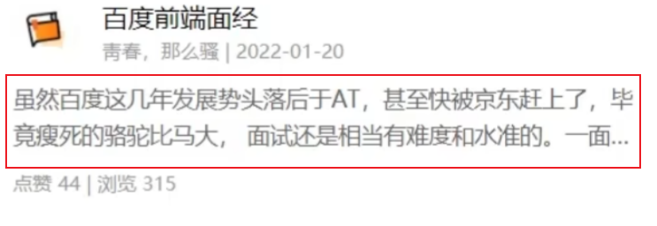

# 文字溢出省略

以下答案来自chatgpt 
```css
/* 单行文本 */
<style>
.text-container {
  width: 200px; /* 容器的宽度 */
  white-space: nowrap; /* 防止换行 */
  overflow: hidden; /* 隐藏超出部分 */
  text-overflow: ellipsis; /* 显示省略号 */
}
</style>

/* 多行文本 */
.text-container {
  display: -webkit-box;
  -webkit-line-clamp: 3; /* 显示 3 行文本 */
  -webkit-box-orient: vertical;
  overflow: hidden;
  text-overflow: ellipsis;
  height: 60px; /* 设置高度，限制显示行数 */
}
```
-webkit-line-clamp 依然是实现多行文本截断并显示省略号的主流方法  
新版本的浏览器仍然可以支持这个属性，但它是 Webkit 引擎特有的  
为了保证兼容性，可以加上 -webkit 前缀。  
# 长单词强制折行
(避免撑破容器)
```css
    word-break: break-all;    // 强制所有字符内折行（中英文都生效）
    overflow-wrap: break-word;// 针对长单词/URL 的折行（word-wrap 的新标准）
    white-space: normal;      // 恢复默认换行规则，配合折行属性生效
```

# 添加滚动条
在会溢出的父容器添加
```css
overflow-y: auto;
```
更美观:
```css
/* 在 Webkit 浏览器中自定义滚动条 */
.experience-container::-webkit-scrollbar {
  width: 8px; /* 设置滚动条的宽度为 8px */
}

/* 自定义滚动条滑块（可以拖动的部分） */
.experience-container::-webkit-scrollbar-thumb {
  background: #888; /* 设置滑块的背景颜色为灰色 (#888) */
  border-radius: 4px; /* 设置滑块的圆角半径为 4px，使滑块的角变圆润 */
}

/* 当鼠标悬停在滚动条滑块上时，改变滑块的背景颜色 */
.experience-container::-webkit-scrollbar-thumb:hover {
  background: #555; /* 设置滑块在鼠标悬停时的背景颜色为深灰色 (#555) */
}

```