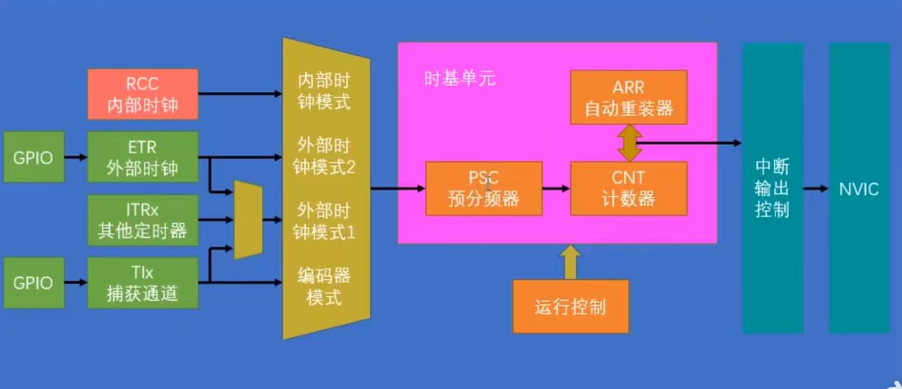

# 定时器(TIM)

## 框图



时钟源 → 从模式控制器选时钟 → 时基单元计数 → 中断输出控制 → NVIC。

| 区块 | 作用 |
|---|---|
| RCC 内部时钟 | 最常用,APB1/APB2 时钟经倍频后进来 |
| ETR / ITRx / TIx | 外部时钟引脚 / 其他定时器级联 / 捕获通道脉冲 |
| 从模式控制器 | 内部时钟、外部时钟 1/2、编码器模式,四选一 |
| 时基单元 | PSC 预分频 → CNT 计数,ARR 定上限 |
| 中断输出控制 | 更新/捕获/比较事件往 NVIC 送请求 |

`CNT` 每个时钟 +1,数到 `ARR` 归零并产生更新事件。

```
计数频率 = 时钟 / (PSC + 1)
溢出周期 = (ARR + 1) / 计数频率
```

## 三个寄存器

| 寄存器 | 作用 | 注意 |
|---|---|---|
| **PSC** 预分频 | 给输入时钟降频 | 写"实际值 - 1" |
| **CNT** 计数器 | 每时钟 +1 | 读它就能看当前计到几 |
| **ARR** 自动重装 | CNT 的上限 | 写"实际值 - 1";到顶即产生更新事件 |

PSC/ARR 有影子寄存器,运行中改要等下一次更新事件才生效。

## 初始化(`Timer.c`)

```c
void Timer_Init(void){
	//1 时钟：TIM2 在 APB1,不是 APB2
	RCC_APB1PeriphClockCmd(RCC_APB1Periph_TIM2, ENABLE);

	//2 时钟源：内部 72MHz
	TIM_InternalClockConfig(TIM2);

	//3 时基单元
	TIM_TimeBaseInitTypeDef timObj = { 0 };
	timObj.TIM_ClockDivision     = TIM_CKD_DIV1;      // 只影响输入捕获,普通定时无关
	timObj.TIM_CounterMode       = TIM_CounterMode_Up;
	timObj.TIM_Period            = 10000 - 1;         // ARR
	timObj.TIM_Prescaler         = 7200 - 1;          // PSC
	timObj.TIM_RepetitionCounter = 0;                 // 高级定时器才用
	TIM_TimeBaseInit(TIM2, &timObj);

	//4 开更新中断（必须在 NVIC 之前）
	TIM_ITConfig(TIM2, TIM_IT_Update, ENABLE);

	//5 NVIC
	NVIC_PriorityGroupConfig(NVIC_PriorityGroup_2);
	NVIC_InitTypeDef NVIC_InitStructure = { 0 };
	NVIC_InitStructure.NVIC_IRQChannel                   = TIM2_IRQn;
	NVIC_InitStructure.NVIC_IRQChannelCmd                = ENABLE;
	NVIC_InitStructure.NVIC_IRQChannelPreemptionPriority = 2;   // 编码器 EXTI 是 1,比它高
	NVIC_InitStructure.NVIC_IRQChannelSubPriority        = 1;
	NVIC_Init(&NVIC_InitStructure);

	//6 启动计数（少了这句前面全白配）
	TIM_Cmd(TIM2, ENABLE);
}
```

参数推算:

```
72MHz / 7200 = 10kHz        // 0.1ms 一个数
10kHz / 10000 = 1Hz         // 1 秒一次中断
```

`uint16_t` 最大 65535 秒,约 18 小时归零。

头文件 `Timer.h` 只声明 `void Timer_Init(void);`。`main.c` 在 `user/` 下,写 `#include "../Timer.h"`,不依赖 Include Paths。

## main.c

```c
volatile uint16_t num;      // 被中断改写,必须 volatile;Timer.c 里 extern 也要带

int main(void)
{
	CountSensor_Init();
	Timer_Init();
	OLED_Init();
	OLED_ShowString(1, 1, "Num:");

	while(1)
	{
		OLED_ShowNum(1, 7, num, 5);// 主循环只显示,计数交给中断
	}
}

void TIM2_IRQHandler(void)
{
	if (TIM_GetITStatus(TIM2, TIM_IT_Update) == SET)
	{
		num++;
		TIM_ClearITPendingBit(TIM2, TIM_IT_Update);// 不清会反复进中断
	}
}
```

- 函数名由向量表定死,只能是 `TIM2_IRQHandler`,写错不会报错、但永不执行;重定义即覆盖启动文件里的弱定义,无需头文件声明。
- `TIM_GetITStatus` / `TIM_ClearITPendingBit` 管"中断",`TIM_GetFlagStatus` / `TIM_ClearFlag` 管"标志",两套位别混。
- ISR 里只做 `num++`,耗时操作丢主循环。

## 坑

| 现象 | 原因 |
|---|---|
| 完全不动 | 时钟开在 APB2;或忘了 `TIM_Cmd` |
| 进一次就卡死 | 没清标志位 |
| 周期差几倍 | PSC/ARR 漏了 -1;或以为 TIM2 是 36MHz(APB1 分频≠1 时定时器时钟 ×2,仍 72MHz) |
| 上电立刻跳一次 | `TIM_TimeBaseInit` 内部置 UG 立刻产生更新事件。要等满一拍,在 `TIM_ITConfig` 前加 `TIM_ClearFlag(TIM2, TIM_IT_Update);` |
| 屏幕一直 0 | `num` 没 `volatile`;或跨文件 `extern` 类型不一致(不报错,但会写坏相邻变量) |
| 数字乱跳 | ISR 里做了延时/刷屏/打印 |
