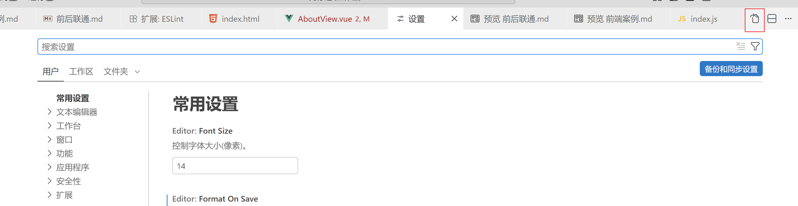

# 后端
## lombok在使用之初失效
根源:IDEA没有正确识别注解处理器
解决方法一:
IDEA右边侧边栏>maven>生命周期>clean>compile  
搞好后字节码文件(.class)会有get和set 但还有可能出现没有彻底解决的情况
解决方法二:
```xml
<annotationProcessorPaths>
    <path>
        <groupId>org.projectlombok</groupId>
        <artifactId>lombok</artifactId>
        <!--这一步是重点-->
        <version>${lombok.version}</version>
        <!--这一步是重点-->
    </path>
</annotationProcessorPaths>
```
这样搞完之后应该就没事了
# 前端
## ESLint启用自动规范

```json
//在原有的后面添加
{
    //保存时eslint自动修复
    "editor.codeActionsOnSave": {
        "source.fixAll.eslint": "always"
    },
    //保存代码不自动格式化
    "editor.formatOnSave": false
}
```
## 全局关闭组件名多单词
在项目根目录的 .eslintrc.js（或 .eslintrc）文件中，添加规则配置：
```javascript
module.exports = {
  // ...其他配置
  rules: {
    // 关闭组件名必须是多单词的校验
    'vue/multi-word-component-names': 'off'
  }
}
```
## Elment-plus
### 初步导入
1. 安装插件  
pnpm add elment-plus  
pnpm install -D unplugin-vue-components unplugin-auto-import  
pnpm i @element-plus/icons-vue(Element Plus 官方为 Vue 3 专门提供的图标库)
2. 在vite.config.js
```javascript
import { defineConfig } from 'vite'
import AutoImport from 'unplugin-auto-import/vite'
import Components from 'unplugin-vue-components/vite'
import { ElementPlusResolver } from 'unplugin-vue-components/resolvers'

export default defineConfig({
  // ...
  plugins: [
    // ...
    AutoImport({
      resolvers: [ElementPlusResolver()],
    }),
    Components({
      resolvers: [ElementPlusResolver()],
    }),
  ],
})
```